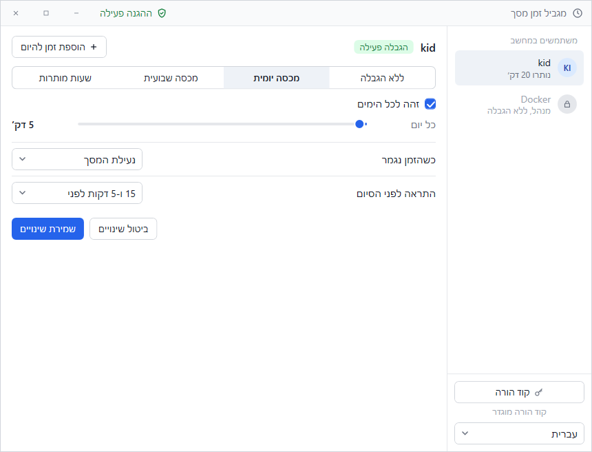

<div dir="rtl">

# מגביל זמן מסך

[English](README.md) · **עברית**

מגביל את זמן השימוש של משתמשים מקומיים במחשב Windows. מנהל המחשב קובע לכל משתמש אחת מהאפשרויות:

- **מכסה יומית:** כך וכך שעות ביום, זהה לכל הימים או שונה לכל יום בשבוע.
- **מכסה שבועית:** כך וכך שעות בשבוע, ואם רוצים גם מקסימום ליום.
- **שעות מותרות:** טווח שעות "מ–עד", זהה לכל הימים או שונה לכל יום בשבוע.

הממשק בעברית (מימין לשמאל) או באנגלית, ואפשר להחליף ביניהן במסך ההגדרות.

⬇️ **הורדה:** [הגרסה האחרונה](https://github.com/tcbr10/screen-time-limiter/releases/latest) – מחלצים את הקובץ ולוחצים לחיצה כפולה על `Install.cmd`.
אין צורך להתקין שום דבר נוסף.

📖 **[מדריך התקנה ושימוש מלא](docs/user-guide-he.md)** – צעד אחר צעד, עם צילומי מסך.

> **מצב הפרויקט (16.11.2026):** נבנה ללא אזהרות, 47 בדיקות הכללים עוברות, והתוכנה הותקנה ונבדקה מקצה לקצה
> על מחשב וירטואלי עם Windows 11. פירוט מה נבדק ומה עוד פתוח: [HANDOFF.md](HANDOFF.md) (באנגלית).

| מסך ההגדרות | מסך "הזמן נגמר" |
| --- | --- |
|  |  |

## איך זה עובד

| רכיב | רץ בתור | תפקיד |
| --- | --- | --- |
| `ScreenLimiter.Service` | SYSTEM, שירות Windows | סופר זמן, שומר הגדרות ואוכף את המגבלות. כל ההחלטות מתקבלות כאן. |
| `ScreenLimiter.Agent` | המשתמש המוגבל | סמל במגש המערכת עם הזמן שנותר, התראות ומסך "הזמן נגמר". לא מחליט דבר. |
| `ScreenLimiter.Admin` | מנהל עם הרשאות מוגבהות | מסך ההגדרות. Windows מבקש אישור מנהל בכל פתיחה. |
| `ScreenLimiter.Core` | (ספרייה) | כללים, מודלים וטקסטים. בלי תלות ב-Windows, כך שאפשר לבדוק אותה בכל מחשב. |

הזמן נספר רק כשהמשתמש מחובר והמסך לא נעול. כשהזמן נגמר:

1. הסוכן מכסה את המסך ומציין מתי יהיה שוב זמן ("זמן נוסף יתחיל מחר ב-00:00").
   הורה יכול להקליד שם את קוד ההורה וללחוץ Enter כדי להוסיף בין רבע שעה לשעה.
2. אם המסך הזה לא מוצג (הסוכן נסגר או הופסק), השירות מנתק את ההפעלה למסך הכניסה של Windows,
   ושוב בכל פעם שהמשתמש חוזר.
3. כשנבחר "ניתוק המשתמש", המשתמש מנותק מ-Windows 30 שניות אחרי שהזמן נגמר.

## בנייה והתקנה מקוד המקור (במחשב Windows)

1. התקינו את ‎[‎.NET 10 SDK](https://dotnet.microsoft.com/download)
2. פתחו PowerShell **כמנהל** בתיקייה הזו.
3. הריצו את הבדיקות, ואז התקינו:

<div dir="ltr">

```powershell
dotnet test
Set-ExecutionPolicy -Scope Process Bypass
.\scripts\install.ps1
```

</div>

4. פתחו את **Screen Limiter** מתפריט התחל, הגדירו קוד הורה, בחרו משתמש וקבעו מגבלה.

להסרה: ‎`.\scripts\uninstall.ps1` (הוסיפו ‎`-RemoveData` כדי למחוק גם את המגבלות השמורות).

לבניית חבילת ההורדה (קובץ zip עצמאי עם `Install.cmd` ו-`Uninstall.cmd`): ‎`.\scripts\package.ps1`.
הקובץ נוצר ב-‎`out\ScreenLimiter-<version>.zip`.

## מה מקשה לעקוף אותה

הכול נשען על כלל אחד: **המשתמשים המוגבלים חייבים להיות חשבונות רגילים, לא מנהלים.** ואז:

- השירות רץ בתור SYSTEM; משתמש רגיל לא יכול לעצור, לשנות או להסיר אותו.
- ההגדרות ונתוני השימוש נשמרים ב-‎`C:\ProgramData\ScreenLimiter`, ורק SYSTEM ומנהלים יכולים לקרוא ולכתוב שם.
- השירות בודק דרך Windows מי שולח כל בקשה. רק מנהל עם הרשאות מוגבהות יכול לשנות הגדרות;
  משתמש רגיל יכול רק לקרוא את המצב של עצמו.
- סגירת הסוכן לא עוזרת: השירות מפעיל אותו מחדש, ואם צריך מנתק את ההפעלה.
- הזמן נספר בשעון שאינו תלוי בשעון המחשב, והחזרת השעון אחורה לא מאפסת את היום.
- הימים והשעות המותרות נקבעים לפי אזור הזמן ששמר המנהל, כך ששינוי אזור הזמן של המחשב
  (שמשתמש רגיל רשאי לעשות) לא מזיז אותם.
- השירות רשום לפעול גם במצב בטוח (Safe Mode), שכל אחד יכול לבחור ממסך הכניסה.
- קוד ההורה נשמר כגיבוב (hash) עם מלח, ואחרי חמישה ניסיונות שגויים הקלדת הקוד ננעלת לחמש דקות.

התוכנה לא עוצרת מי שיודע סיסמה של מנהל, מפעיל מערכת הפעלה אחרת מדיסק-און-קי או מתקין מחדש את Windows.
לשם כך השתמשו בסיסמת BIOS וב-BitLocker.

הוספות זמן, ניתוקים ויציאות נרשמים ביומן "יישום" של Windows, תחת המקור `ScreenLimiter`.

## בהמשך

[docs/remote-control-plan.md](docs/remote-control-plan.md) (באנגלית) מתאר איך תתווסף אפשרות לנהל מחשבים ברשתות אחרות.

</div>
