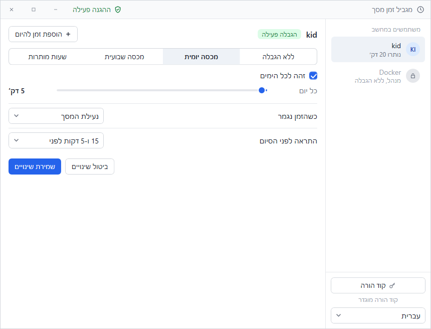
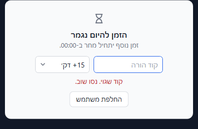

# Screen Limiter

Limits how long local users can use a Windows PC. An administrator sets, per user, one of:

- **Daily limit**: so many hours a day, the same every day or different per weekday.
- **Weekly limit**: so many hours a week, with an optional cap per day.
- **Allowed hours**: a from–to window, the same every day or different per weekday.

The interface is in Hebrew (right-to-left) or English, switchable in the admin console.

**Download:** [latest release](https://github.com/tcbr10/screen-time-limiter/releases/latest) — unzip, double-click `Install.cmd`.
Nothing else needs to be installed.
**מדריך התקנה ושימוש בעברית:** [docs/user-guide-he.md](docs/user-guide-he.md)

> **Status (2026-11-16):** builds with no warnings, 47 rule tests pass, installed and tested end to end on a
> Windows 11 VM. See [HANDOFF.md](HANDOFF.md) for what was checked and what is still open.

| Admin console | Lock screen |
| --- | --- |
|  |  |

## How it works

| Part | Runs as | Job |
| --- | --- | --- |
| `ScreenLimiter.Service` | SYSTEM, Windows service | Counts time, stores settings, enforces limits. All decisions happen here. |
| `ScreenLimiter.Agent` | The limited user | Tray icon with time left, warnings, the "time's up" screen. Decides nothing. |
| `ScreenLimiter.Admin` | Elevated administrator | The settings console. Windows asks for admin approval each time it opens. |
| `ScreenLimiter.Core` | (library) | Rules, models, texts. No Windows dependencies, so it is unit-tested anywhere. |

Time counts only while the user's session is active and unlocked. When time runs out:

1. The agent covers the screen and says when time comes back ("More time starts tomorrow at 00:00").
   A parent can type the PIN there and press Enter to add 15 minutes to an hour.
2. If the agent isn't showing that screen (closed, killed), the service disconnects the session to the Windows
   sign-in screen, and does so again each time the user comes back.
3. With "Sign the user out" selected, the user is signed out 30 seconds after time runs out.

## Build and install from source (on the Windows PC)

1. Install the [.NET 10 SDK](https://dotnet.microsoft.com/download).
2. Open PowerShell **as administrator** in this folder.
3. Run the tests, then install:

   ```powershell
   dotnet test
   Set-ExecutionPolicy -Scope Process Bypass
   .\scripts\install.ps1
   ```

4. Open **Screen Limiter** from the Start menu, set a parent PIN, pick a user, and set a limit.

To remove it: `.\scripts\uninstall.ps1` (add `-RemoveData` to delete saved limits too).

To build the download package (a self-contained zip with `Install.cmd` / `Uninstall.cmd`): `.\scripts\package.ps1`.
It lands in `out\ScreenLimiter-<version>.zip`.

## What makes it hard to bypass

It relies on one rule: **limited users must be standard accounts, not administrators.** Then:

- The service runs as SYSTEM; standard users can't stop, change, or uninstall it.
- Settings and usage live in `C:\ProgramData\ScreenLimiter`, readable and writable only by SYSTEM and administrators.
- The service checks, through Windows, who is on the other end of each request. Only an elevated administrator
  can change settings; a user can only read their own status.
- Killing the agent gains nothing: the service restarts it and falls back to disconnecting the session.
- Time is counted with a monotonic timer, and moving the clock backwards doesn't reset the day.
- Days and allowed hours follow the time zone saved by the administrator, so changing the PC's time zone
  (which standard users may do) doesn't move them.
- The service is registered to run in Safe Mode too, which anyone can pick from the sign-in screen.
- The parent PIN is stored as a salted hash, and five wrong tries lock PIN entry for five minutes.

It does not stop someone who knows an administrator password, boots another operating system from USB, or
reinstalls Windows. Use a BIOS password and BitLocker for those.

Grants, disconnects and sign-outs are written to the Windows Application log under the source `ScreenLimiter`.

## Later

[docs/remote-control-plan.md](docs/remote-control-plan.md) describes how managing PCs on other networks will be added.
