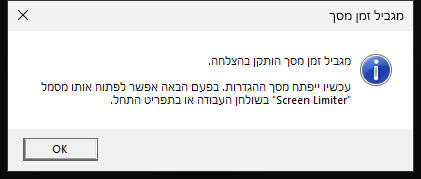
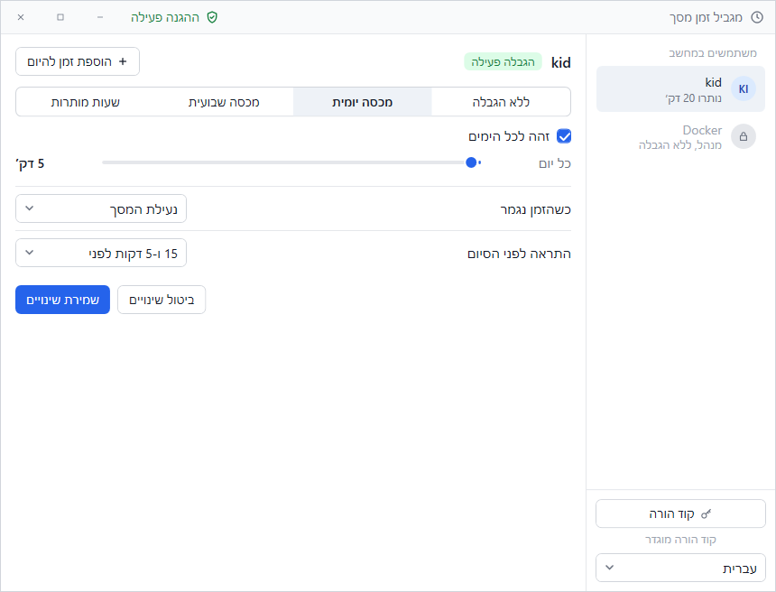
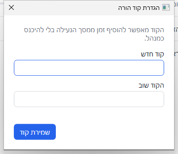
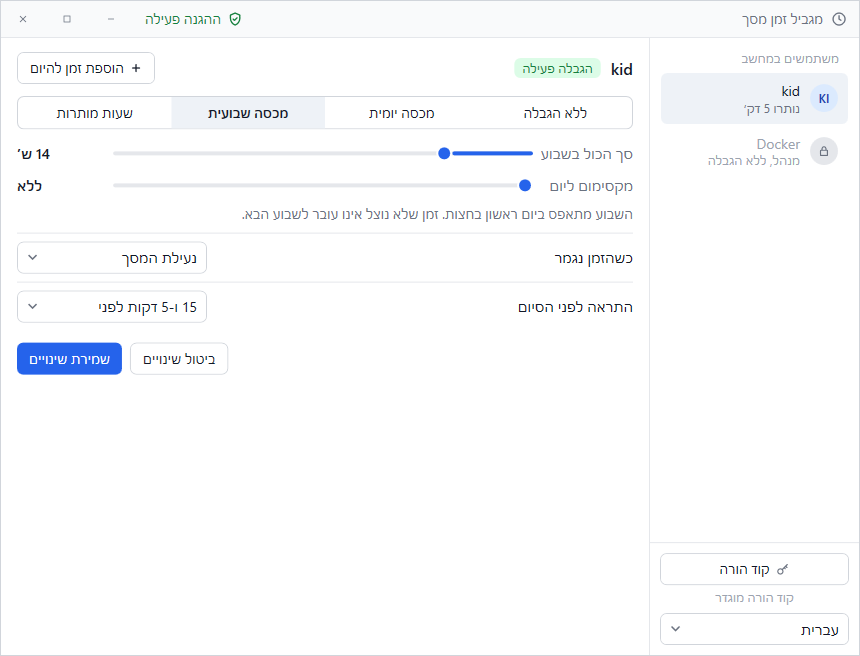
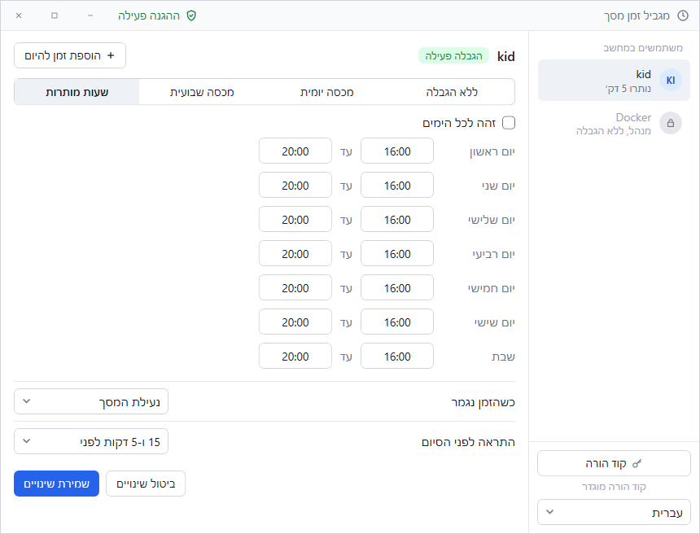
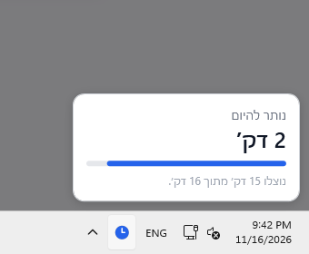
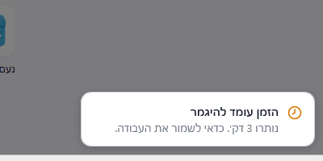
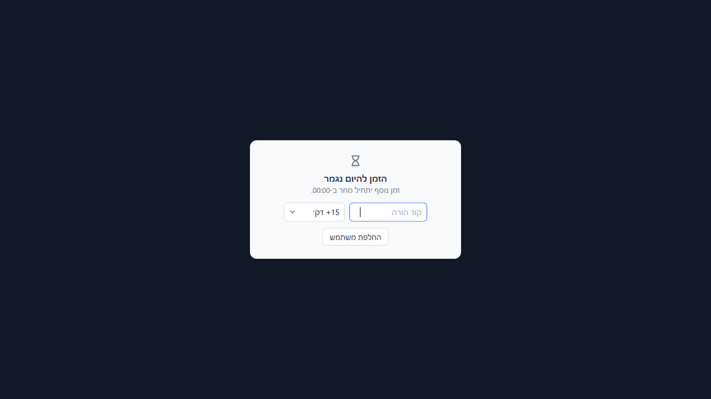
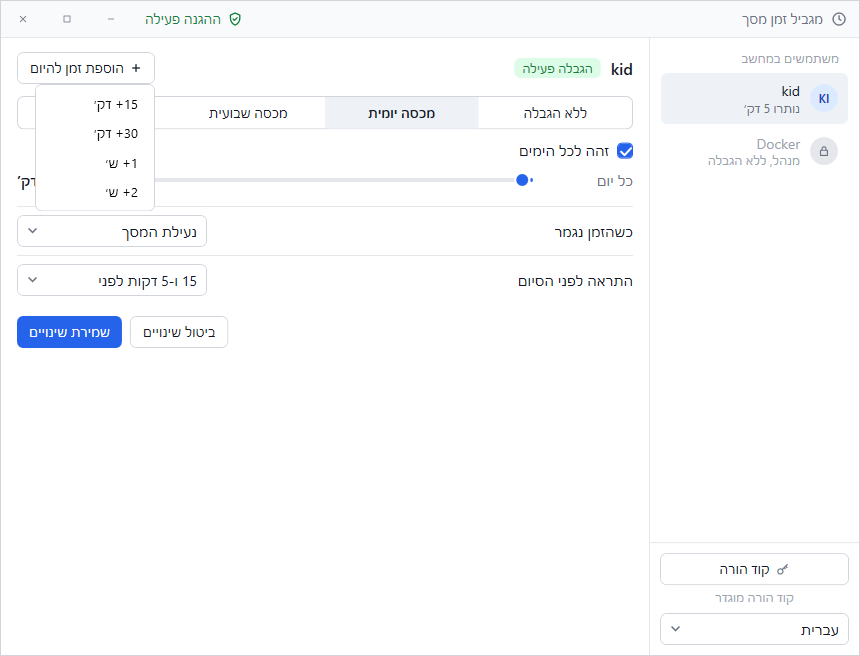

# מגביל זמן מסך – מדריך התקנה ושימוש

מגביל זמן מסך היא תוכנה חינמית למחשבי Windows שמגבילה כמה זמן ילדים (או כל משתמש אחר) יכולים להשתמש במחשב.
ההורה קובע את המגבלה, והתוכנה דואגת לשאר: היא סופרת את הזמן, מזהירה לפני שהוא נגמר, ונועלת את המסך כשהזמן תם.

**מה אפשר להגדיר לכל משתמש:**

- **מכסה יומית** – למשל שעתיים ביום. אפשר זמן זהה לכל הימים, או זמן שונה לכל יום (למשל יותר בסוף השבוע).
- **מכסה שבועית** – למשל 14 שעות בשבוע, ואם רוצים גם מקסימום ליום.
- **שעות מותרות** – למשל רק בין 16:00 ל-20:00. גם כאן אפשר שעות זהות לכל הימים או שונות לכל יום.

---

## תוכן העניינים

1. [לפני שמתחילים](#לפני-שמתחילים)
2. [התקנה](#התקנה)
3. [פתיחת מסך ההגדרות](#פתיחת-מסך-ההגדרות)
4. [הגדרת קוד הורה](#הגדרת-קוד-הורה)
5. [הגדרת מגבלת זמן](#הגדרת-מגבלת-זמן)
6. [מה הילד רואה](#מה-הילד-רואה)
7. [הוספת זמן](#הוספת-זמן)
8. [שאלות נפוצות ופתרון בעיות](#שאלות-נפוצות-ופתרון-בעיות)
9. [הסרת התוכנה](#הסרת-התוכנה)

---

## לפני שמתחילים

**מה צריך:**

- מחשב עם Windows 10 או Windows 11.
- **חשבון מנהל להורה** – החשבון שאיתו מתקינים ומגדירים. **חשוב שתהיה לו סיסמה**, אחרת הילד יוכל להיכנס אליו ולשנות הכול.
- **חשבון נפרד לכל ילד, מסוג "משתמש רגיל"** (לא מנהל). התוכנה לא מגבילה חשבונות מנהל, כי מנהל יכול להסיר כל תוכנה.

### איך יוצרים חשבון לילד

1. פתחו את **הגדרות** (מקש Windows + I).
2. בחרו **חשבונות** ← **משתמשים אחרים** (ב-Windows 10: **משפחה ומשתמשים אחרים**).
3. לחצו **הוסף חשבון**.
4. אם אין לילד חשבון Microsoft, בחרו **אין לי את פרטי הכניסה של אדם זה** ← **הוסף משתמש ללא חשבון Microsoft**, ומלאו שם וסיסמה.
5. החשבון החדש נוצר כ"משתמש רגיל" – בדיוק מה שצריך.

### איך בודקים שחשבון קיים הוא "משתמש רגיל"

ב**הגדרות** ← **חשבונות** ← **משתמשים אחרים**, לחצו על שם הילד ← **שנה סוג חשבון**, וודאו שנבחר **משתמש רגיל**.

> **שימו לב:** חשבון חדש מופיע ברשימת המשתמשים של התוכנה רק אחרי שהילד נכנס אליו לפחות פעם אחת.

---

## התקנה

ההתקנה לוקחת פחות מדקה, ואין צורך להתקין שום דבר נוסף.

1. **הורידו** את הקובץ `ScreenLimiter-0.1.0.zip` מ[דף ההורדות](https://github.com/tcbr10/screen-time-limiter/releases/latest)
   (תחת **Assets**).
2. **חלצו את הקובץ:** לחצו עליו בלחצן הימני של העכבר ← **חלץ הכול** ← **חלץ**.
   > חשוב לחלץ. אם פותחים את ה-zip בלחיצה כפולה ומפעילים משם, ההתקנה לא תעבוד.
3. בתיקייה שנפתחה, לחצו לחיצה כפולה על **`Install.cmd`**.
4. ייתכן שיופיע חלון כחול **"Windows הגן על המחשב שלך"**. זה קורה עם כל תוכנה שהורדה מהאינטרנט ואין לה חתימה של חברה מסחרית.
   לחצו **מידע נוסף** ← **הפעל בכל זאת**.
5. Windows ישאל **"האם לאפשר לאפליקציה זו לבצע שינויים במכשיר?"** – לחצו **כן**.
   (אם אתם לא מחוברים כמנהל, תתבקשו להקליד את סיסמת המנהל.)
6. ייפתח חלון שחור שבו ההתקנה רצה, ואחריה הודעה שההתקנה הושלמה. לחצו **OK**.

מסך ההגדרות ייפתח מעצמו. מעכשיו התוכנה פועלת ברקע בכל הפעלה של המחשב – אין צורך לעשות שום דבר נוסף.

את התיקייה שחילצתם אפשר למחוק אחרי ההתקנה, אבל כדאי לשמור אותה: בה נמצא גם קובץ ההסרה.

---

## פתיחת מסך ההגדרות

לחצו לחיצה כפולה על הסמל **Screen Limiter** בשולחן העבודה, או חפשו **Screen Limiter** בתפריט התחל.
Windows יבקש אישור מנהל – זה מכוון: רק מנהל יכול לפתוח את מסך ההגדרות ולשנות מגבלות.

**מה רואים במסך:**

- **למעלה משמאל:** "ההגנה פעילה" עם סמל מגן ירוק – התוכנה פועלת. אם מופיעה שם הודעה באדום, ראו [פתרון בעיות](#שאלות-נפוצות-ופתרון-בעיות).
- **מימין:** כל המשתמשים במחשב, ומתחת לכל שם – כמה זמן נותר לו היום. חשבונות מנהל מופיעים באפור עם מנעול, כי אי אפשר להגביל אותם.
- **במרכז:** ההגדרות של המשתמש שבחרתם.
- **למטה מימין:** כפתור **קוד הורה** ובחירת שפה (עברית או English).

---

## הגדרת קוד הורה

קוד ההורה מאפשר להוסיף לילד זמן **ישירות ממסך הנעילה**, בלי להיכנס לחשבון המנהל. מומלץ להגדיר אותו מיד.

1. במסך ההגדרות, לחצו **קוד הורה** (למטה מימין).
2. הקלידו קוד של 4 עד 8 ספרות, ושוב אותו קוד בשורה השנייה.
3. לחצו **שמירת קוד**.

> **שכחתם את הקוד?** פשוט הגדירו קוד חדש באותה דרך. אין צורך בקוד הישן.

---

## הגדרת מגבלת זמן

1. ברשימה מימין, לחצו על שם הילד.
2. בחרו את סוג המגבלה בשורת הכפתורים:

| כפתור | מתי מתאים |
| --- | --- |
| **ללא הגבלה** | המשתמש לא מוגבל (כך מבטלים מגבלה). |
| **מכסה יומית** | כמות זמן לכל יום. |
| **מכסה שבועית** | כמות זמן לכל השבוע, ואפשר גם מקסימום ליום. |
| **שעות מותרות** | המחשב זמין רק בטווח שעות מסוים. |

3. קבעו את הזמן (פירוט לכל סוג בהמשך).
4. בחרו **כשהזמן נגמר**:
   - **נעילת המסך** (מומלץ) – מופיע מסך "הזמן נגמר", והחלונות הפתוחים נשמרים מאחוריו.
   - **ניתוק המשתמש** – המשתמש מנותק מ-Windows כחצי דקה אחרי שהזמן נגמר. **עבודה שלא נשמרה תאבד.**
5. בחרו **התראה לפני הסיום**: 15 ו-5 דקות לפני, רק 5 דקות לפני, או ללא התראה.
6. לחצו **שמירת שינויים**. (**ביטול שינויים** מחזיר את ההגדרות כפי שהיו.)

כשהמגבלה פעילה מופיע ליד שם הילד הסימון הירוק **הגבלה פעילה**.

### מכסה יומית

- כשהתיבה **זהה לכל הימים** מסומנת, יש פס אחד – גררו אותו לכמות הזמן הרצויה.
- בטלו את הסימון כדי לקבוע זמן שונה לכל יום בשבוע.
- הזמן נקבע בקפיצות של רבע שעה. פס על האפס פירושו **חסום** – אין זמן מחשב באותו יום.
- הזמן מתאפס כל לילה בחצות.

### מכסה שבועית

- **סך הכול בשבוע** – כמה זמן מותר בכל השבוע.
- **מקסימום ליום** – לא חובה. מונע מצב שהילד מנצל את כל השבוע ביום אחד. "ללא" פירושו שאין מקסימום יומי.
- השבוע מתאפס ביום ראשון בחצות. זמן שלא נוצל לא עובר לשבוע הבא.

### שעות מותרות

- הקלידו שעת התחלה ושעת סיום בצורה `16:00`.
- אפשר שעות זהות לכל הימים, או לבטל את **זהה לכל הימים** ולקבוע לכל יום בנפרד.
- כדי לחסום יום שלם, קבעו לו שעת התחלה ושעת סיום זהות (למשל `00:00` עד `00:00`).
- הטווח לא יכול לעבור את חצות; השעה המאוחרת ביותר היא `24:00`.

---

## מה הילד רואה

**סמל שעון בשורת המשימות** (ליד השעה). לחיצה עליו מראה כמה זמן נותר:

**התראה לפני שהזמן נגמר** (לפי מה שהגדרתם):

**מסך "הזמן נגמר"** כשהזמן תם. המסך מכסה את כל המחשב, ומציין מתי יהיה שוב זמן:

- הילד לא יכול לסגור את המסך הזה. גם אם ינסה לסגור את התוכנה, Windows ינתק את החשבון שלו תוך שניות.
- הכפתור **החלפת משתמש** נועל את המחשב, כך שהורה או אח יכולים להיכנס לחשבון שלהם.
- הזמן **לא נספר** כשהמסך נעול (למשל אחרי Windows + L), ורק כשהילד באמת מחובר ומשתמש.

---

## הוספת זמן

יש שתי דרכים לתת לילד עוד זמן להיום:

**1. ממסך הנעילה, עם קוד ההורה** (הכי פשוט):
במסך "הזמן נגמר", הקלידו את קוד ההורה בתיבה, בחרו כמה זמן להוסיף (15 דקות, 30 דקות או שעה), ולחצו **Enter**.
המסך נעלם והילד ממשיך מאותה נקודה.

> אחרי 5 ניסיונות שגויים, הקלדת הקוד ננעלת ל-5 דקות – כך ילד לא יכול לנחש את הקוד.

**2. ממסך ההגדרות:**
בחרו את הילד ← **הוספת זמן להיום** ← בחרו כמה (15 דקות עד שעתיים).

זמן נוסף תקף להיום בלבד (במכסה שבועית – גם לשבוע הנוכחי).

---

## שאלות נפוצות ופתרון בעיות

**הילד לא מופיע ברשימת המשתמשים.**
חשבון מופיע רק אחרי שנכנסו אליו לפחות פעם אחת. היכנסו לחשבון של הילד פעם אחת, ואז פתחו שוב את מסך ההגדרות.

**ליד שם הילד כתוב "מנהל, ללא הגבלה".**
החשבון של הילד הוא חשבון מנהל, ולכן אי אפשר להגביל אותו. שנו אותו ל"משתמש רגיל" (ראו [לפני שמתחילים](#לפני-שמתחילים)), ואז פתחו שוב את מסך ההגדרות.

**למעלה כתוב באדום "אין חיבור לשירות".**
החלק של התוכנה שפועל ברקע לא רץ. הפעילו מחדש את המחשב. אם זה לא עוזר, הריצו שוב את `Install.cmd` – ההגדרות שלכם יישמרו.

**סמל השעון לא מופיע בשורת המשימות.**
הסמל מופיע רק אצל משתמש שיש לו מגבלה. אם יש מגבלה והסמל חסר, לחצו על החץ **^** ליד השעה – ייתכן ש-Windows הסתיר אותו שם.

**הילד שינה את השעון או את אזור הזמן.**
זה לא עוזר לו: הזמן נספר בנפרד משעון המחשב, והתוכנה עובדת לפי אזור הזמן שהיה מוגדר כשהמנהל שמר את ההגדרות. משתמש רגיל גם לא יכול לשנות את השעה עצמה.

**המחשב כובה באמצע – האם הזמן נשמר?**
כן. הזמן נשמר כל חצי דקה ונשאר גם אחרי הפעלה מחדש.

**איך רואים מתי הוסף זמן או מתי ילד נותק?**
ב-**מציג האירועים** של Windows (חפשו "Event Viewer" בתפריט התחל) ← **יומני Windows** ← **יישום**, וחפשו רשומות שהמקור שלהן הוא **ScreenLimiter**.

**איך מגבילים כמה ילדים?**
לכל ילד חשבון משלו, ולכל חשבון מגדירים מגבלה בנפרד.

**איך משדרגים לגרסה חדשה?**
הורידו את הגרסה החדשה, חלצו אותה והריצו `Install.cmd`. כל ההגדרות, קוד ההורה והזמן שנוצל נשמרים.

**האם התוכנה אוספת מידע או שולחת משהו לאינטרנט?**
לא. הכול נשמר רק במחשב עצמו, בתיקייה שרק מנהל יכול לפתוח.

**עד כמה קשה לעקוף את התוכנה?**
משתמש רגיל לא יכול לעצור אותה, למחוק אותה, לשנות את ההגדרות או לראות את קוד ההורה. היא פועלת גם במצב בטוח (Safe Mode).
מי שיודע את סיסמת המנהל יכול כמובן לעשות הכול – לכן חשוב לשמור אותה בסוד. כדי להגן גם מפני התקנה מחדש של Windows או הפעלה מדיסק-און-קי, אפשר להגדיר סיסמת BIOS ולהפעיל BitLocker.

---

## הסרת התוכנה

1. בתיקייה שחילצתם בזמן ההתקנה, לחצו לחיצה כפולה על **`Uninstall.cmd`**. (אם מחקתם אותה, הורידו וחלצו שוב את הקובץ.)
2. אשרו את בקשת Windows לשינויים במכשיר.
3. לשאלה **"להסיר את מגביל זמן מסך מהמחשב?"** ענו **כן**.
4. לשאלה **"למחוק גם את ההגדרות השמורות?"**:
   - **כן** – הכול נמחק.
   - **לא** – המגבלות וקוד ההורה נשמרים, ויחזרו אם תתקינו שוב.

אחרי ההסרה אין מגבלות זמן לאף משתמש.

